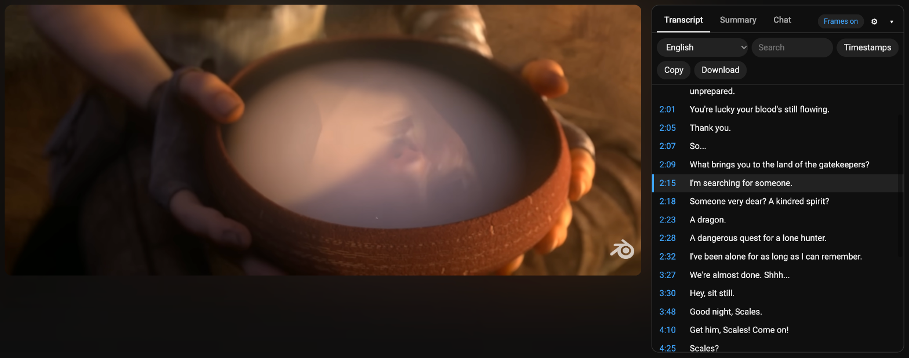
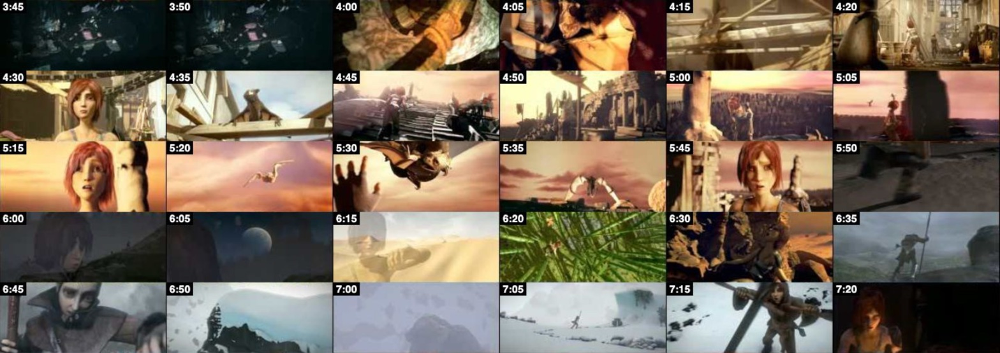
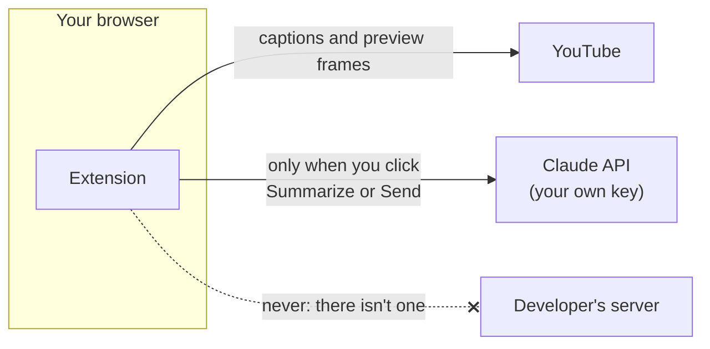

# My YouTube Transcript

A Chrome extension that puts a transcript, AI summary and chat panel next to any YouTube video, without a server in the middle.

Most extensions like this send your videos and questions through the developer's backend. This one has no backend. The transcript is read from YouTube inside your own browser, and AI requests go straight from your browser to the Claude API using your own key.

## What it does

- **Transcript** beside the video: search, language picker, timestamps on or off, copy, download as `.txt`. Click a line to jump there; the line being spoken is highlighted.
- **Summary**: an overview, key points with clickable timestamps, and takeaways.
- **Chat**: ask questions about the video, with follow-ups.
- **Frames** (optional, on by default): Claude also gets still frames from the video, so it can answer questions about slides, charts and what is on screen, and can work on videos that have no captions.

## How Claude "watches" the video

With Frames on, the extension samples up to 120 frames evenly across the video, stamps each with its timestamp, and sends them to Claude alongside the transcript. This is one of the grids Claude receives:

In Chat, the frame on screen at the moment you ask is sent too, at full size, so questions like "what does this slide say?" work.

## Where your data goes

| What | Where it goes |
|---|---|
| Transcript viewing, search, copy, download | Nowhere. Fetched from youtube.com by the page itself. |
| Summary and Chat | The transcript, video title, channel name and your questions go to `api.anthropic.com` with your key, only when you click Summarize or Send. |
| Frames, when on | Preview thumbnails are fetched from `i.ytimg.com` and sent to the Claude API with the request. In Chat, the frame currently on screen is sent too. |
| Your API key | Stored in Chrome's local extension storage on your machine. |

No accounts, no analytics, no other network requests. The code is five small files with no dependencies and no build step, so you can read all of it.

## Install

The extension is not on the Chrome Web Store. Load it unpacked:

1. Download this repository (Code → Download ZIP, then unzip) or clone it.
2. Open `chrome://extensions` and turn on **Developer mode**.
3. Click **Load unpacked** and pick the folder.
4. Open a YouTube video. The panel is at the top of the right-hand column (below the video in theater mode or a narrow window).

The transcript works straight away. For Summary and Chat:

1. Create an API key at [platform.claude.com](https://platform.claude.com). This is separate from a Claude subscription and is billed per use.
2. Click the gear in the panel, paste the key, pick a model, and save.

## Cost

You pay Anthropic directly for what you use. A summary of a 20-minute video with frames is roughly a few cents on Claude Opus 5.5 and well under a cent on Claude Haiku 5.5. Turning Frames off makes requests smaller.

## Limitations

- It relies on unofficial YouTube endpoints (the same data the YouTube apps use for captions and seek-bar previews). YouTube can change these at any time, and the extension will need an update when it does.
- The frames sampled across the video are small (160×90). They are good for scenes, slides and charts, not for fine print. The current frame sent with a Chat question is full size.
- DRM-protected videos (rented films, for example) give black frames, and frames are skipped during ads.
- Only regular watch pages are supported, not Shorts.

## Files

- `manifest.json`: permissions and wiring
- `content.js`: the panel, transcript loading, frame capture
- `background.js`: Claude API calls and frame grids (the only code that reads the API key)
- `options.html`, `options.js`: settings page

## Notes

Screenshots show [Sintel](https://durian.blender.org), © Blender Foundation, licensed under CC BY 3.0.

Built with [Claude Code](https://claude.com/claude-code). Not affiliated with YouTube, Google or Anthropic.

MIT licensed. See [LICENSE](LICENSE).
